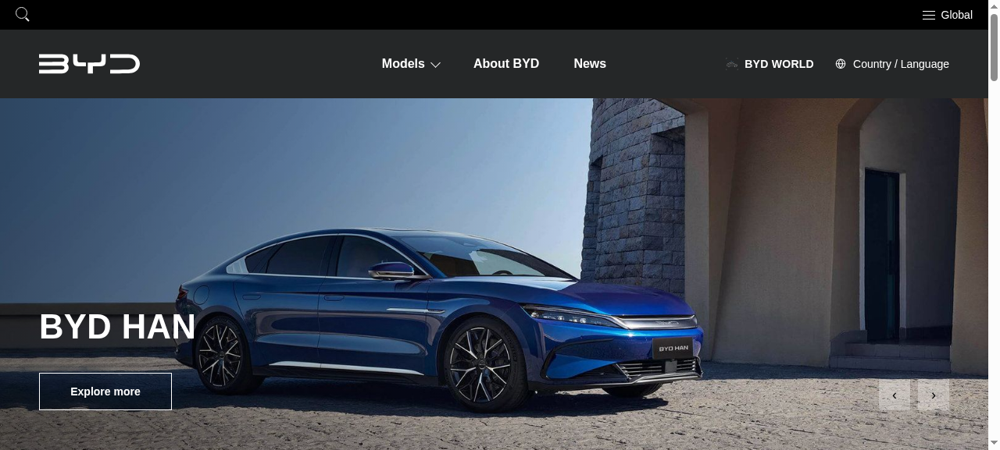

# BYD New Zealand — Static Build

A performance-optimised static build of the BYD New Zealand site — 11 pages, 60 images, 7.3 MB total.

**[→ View the live site](https://ebubechineka.github.io/byd-clone/)**



## What this is

A static build of the BYD New Zealand site, made as a front-end study: how a large automotive brand structures its model pages, and how much weight you can strip out of one without changing a pixel.

This is the **v3 performance build** — 62.8% lighter than the original baseline (21.9 MB → 8.2 MB of page weight) with no visible change to content, layout or styling.

## What's inside

- 11 pages: home, model pages, about, news, contact
- 60 images, all local
- Every link internal — no redirects to the original site
- 62.8% reduction in page weight vs. the baseline

## Technology

- HTML, CSS and JavaScript
- Static site — no build step required
- Deployed on GitHub Pages

## Run it locally

No build step, no dependencies — it's plain HTML, CSS and JavaScript.

```bash
# from the repository root
python3 -m http.server 8000
# then open http://localhost:8000
```

Or just open `index.html` directly in a browser.

## Note

A front-end study build. All brand marks, imagery and copy belong to BYD; the optimisation work is what this repository demonstrates.


---

<sub>Built by **[Benito K Chukwuemeka](https://github.com/Ebubechineka)** · [Golden Vista Global](https://ebubechineka.github.io/golden-vista-global/) — business websites, landing pages and web apps for clients in Nigeria and worldwide.</sub>
